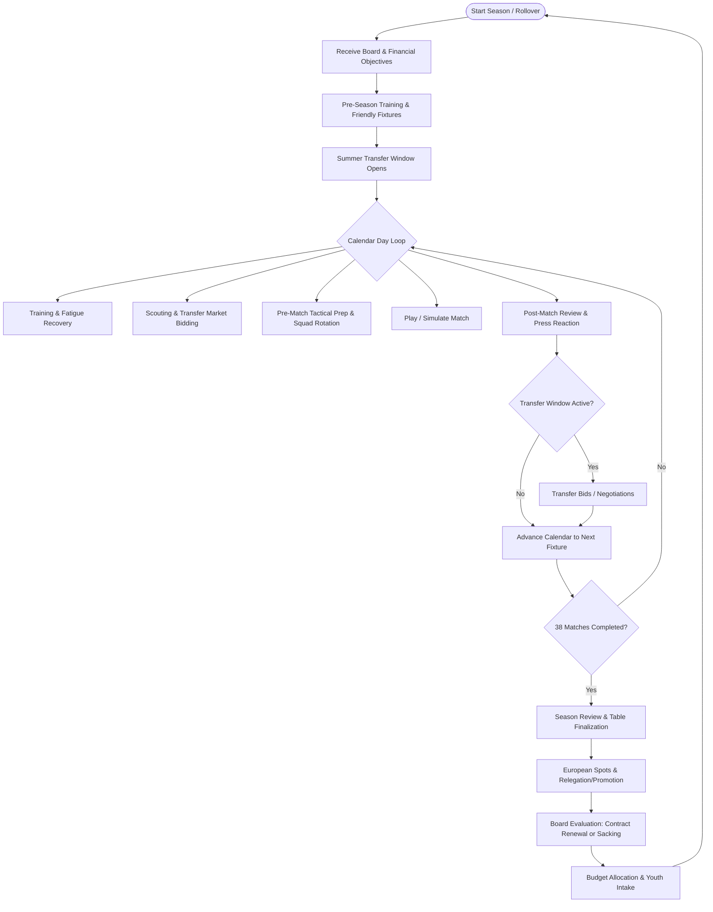
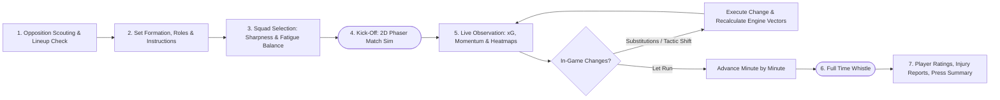
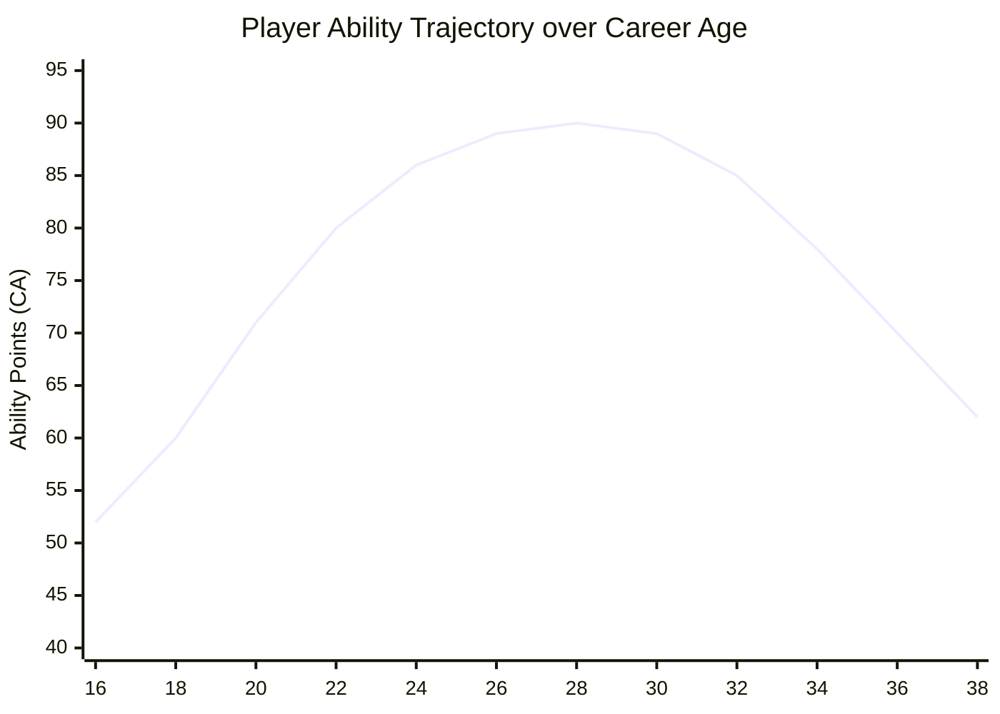
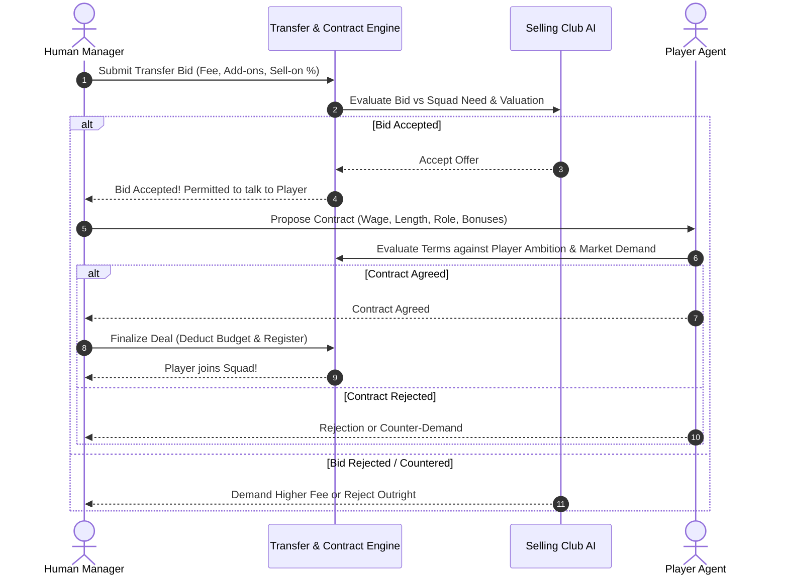

# Game Design Document (GDD): Premier League Football Manager

**Version:** 1.0  
**Target Platform:** Web Browsers (Desktop & Tablet optimized)  
**Genre:** Sports Management / Tactical Simulation  
**Inspirations:** Football Manager series, Championship Manager 01/02, EA FC Career Mode  

---

## 1. Executive Summary & Vision

### 1.1 High Concept
*Premier League Football Manager* is a deep, fast-paced browser-based football management game. Players take the reins of any Premier League club (modern or classic historical eras), managing squad dynamics, tactical setups, boardroom finances, transfer negotiations, and experiencing matches through an interactive 2D top-down pitch visualizer powered by Phaser.

### 1.2 Core Pillars
1. **Meaningful Tactical Autonomy**: Tactics are not arbitrary sliders. Formations, player roles, and situational team instructions directly dictate player spatial movement, passing lanes, pressing triggers, and defensive line geometry.
2. **Accessible Depth**: Captures the rich depth of Football Manager while maintaining the rapid, fluid seasonal progression of classic Championship Manager and EA FC Career Mode (completing a season in 2–4 hours).
3. **Decoupled 2D Simulation Engine**: A deterministic, headless match simulation engine capable of computing a 90-minute match in under 50 milliseconds while generating full 2D positional keyframes for real-time or highlight replay.
4. **Living Football Ecosystem**: All 20 Premier League clubs actively scout, bid, adjust tactics, suffer injuries, develop youth talent, and face sacking pressure under authentic financial constraints (including Premier League Profitability and Sustainability Rules - PSR).

---

## 2. The Core Gameplay Loops

### 2.1 The Macro Loop (Season Progression)

### 2.2 The Micro Loop (Matchday Experience)

---

## 3. Player Attributes & Progression System

### 3.1 Attribute Scale
Attributes use a **1–99 scale** (similar to modern football games for granular progression), mapped internally to standard deviation tiers (Mean = 50, Elite = 85–99, League Average = 65–75).

### 3.2 Attribute Taxonomy

| Category | Attributes | Impact in Simulation Engine |
| :--- | :--- | :--- |
| **Physical** | Pace, Acceleration, Stamina, Strength, Agility, Jumping Reach | Movement speed vector on pitch, recovery runs, duel win rate, late-game attribute decay due to fatigue. |
| **Technical** | Finishing, Passing, Dribbling, Tackling, Heading, First Touch, Crossing, Long Shots, Marking | Execution probability of active events (shot on target %, pass completion vector, ball retention under pressure). |
| **Mental** | Composure, Vision, Positioning, Decisions, Work Rate, Aggression, Bravery, Leadership | Decision latency (ticks before selecting action), spotting passing angles, holding defensive line vs chasing, rallying team morale. |
| **Goalkeeping** | Reflexes, Handling, Positioning, Shot Stopping, Distribution, Command of Area | 1v1 reaction time, parry vs catch probability, cross interception radius, launching counter-attacks. |
| **Hidden / Traits** | Consistency, Big Matches, Injury Proneness, Professionalism, Ambition, Loyalty | Variance applied to base attributes in high-pressure matches, frequency of muscle/contact injuries, training progression rates. |

### 3.3 Condition, Sharpness, Morale & Form

1. **Condition (0–100%)**:
   - Drops during match play at a rate governed by player `Stamina`, team `Pressing Intensity`, and `Tempo`.
   - Condition below 70% drastically increases injury probability and lowers `Pace`, `Decisions`, and `Work Rate` by up to 25%.
   - Recovers between fixtures based on club Medical Facility tier and rest days.
2. **Match Sharpness (0–100%)**:
   - Represents match fitness. Decreases with lack of game time; increases with consecutive competitive minutes.
   - Low sharpness introduces variance/errors into `First Touch` and `Finishing`.
3. **Morale (1–5 scale: Very Poor, Poor, Okay, Good, Superb)**:
   - Driven by playing time promises, team results, contract status, and manager interactions.
   - Boosts or penalizes mental attributes (`Composure`, `Decisions`).
4. **Form (Rolling 5-Match Average Rating: 1.0–10.0)**:
   - Influences player market value, transfer interest from AI clubs, and squad hierarchy confidence.

### 3.4 Player Development & Aging Curve

Every player possesses:
- **Current Ability (CA)**: Computed dynamically from weighted positional attributes (1–99).
- **Potential Ability (POT)**: Absolute ceiling for the player's career.

- **Growth Factors (Ages 16–24)**:
  $$\Delta \text{Attribute} = f(\text{Minutes Played}, \text{Match Rating}, \text{Training Facilities}, \text{Professionalism}, \text{POT} - \text{CA})$$
- **Peak Years (Ages 25–29)**: Attribute stability. Growth shifts toward mental attributes (`Vision`, `Positioning`, `Leadership`).
- **Decline Curve (Ages 30+)**:
  - `Pace`, `Acceleration`, and `Stamina` degrade first (-2 to -6 points per season).
  - High `Natural Fitness` and `Professionalism` significantly decelerate physical degradation.
  - Mental attributes remain stable or improve until retirement.

---

## 4. Club Management System

### 4.1 Financial Model
Every club operates under realistic English football accounting:
- **Balance**: Total liquid funds.
- **Transfer Budget**: Liquid cash earmarked for player acquisition fees and agent costs.
- **Wage Budget**: Weekly wage expenditure allowance approved by the board.
- **Revenue Streams**:
  - Premier League TV Rights distribution (equal share + merit payment based on league position + facility fees).
  - Matchday Gate Receipts (ticket prices $\times$ stadium capacity $\times$ average attendance).
  - Commercial & Kit Sponsorship deals (fixed seasonal contracts tied to club reputation).
  - Prize Money (Domestic Cups, Champions League / Europa League progression).
- **Expenditures**:
  - Player & Staff Weekly Wages.
  - Youth Academy & Training Facility Maintenance.
  - Scouting Network Operating Costs.
  - Transfer Fee Amortization (spreading transfer fee expense over contract lifespan).

### 4.2 Premier League PSR (Profitability & Sustainability Rules)
- Clubs cannot exceed £105m in allowable operational losses over a rolling 3-season monitoring period.
- Breaching PSR incurs:
  1. Board-enforced transfer embargo.
  2. Potential Premier League point deductions (4 to 10 points) applied in the subsequent season.

### 4.3 Board Expectations & Job Security
- The board evaluates the manager monthly on a **Confidence Meter (0–100%)**.
- Key Evaluation Pillars:
  1. **League Performance**: Target finish (e.g., Avoid Relegation, Top Half, European Qualification, Title Contender).
  2. **Financial Health**: Maintaining wage budget compliance and positive cash balance.
  3. **Domestic Cup Run**: Reaching specific rounds (e.g., FA Cup Quarter-Finals).
  4. **Youth Integration**: Promoting academy graduates into first-team minutes.
- If confidence drops below 25% for more than two consecutive months, the board triggers termination and game over.

---

## 5. Transfer Market & Contract Negotiations

### 5.1 Player Valuation Algorithm
Market value ($V$) is determined using a realistic multi-factor formula:
$$V = \text{Base}(\text{CA}, \text{Position}) \times M_{\text{POT}} \times M_{\text{Age}} \times M_{\text{Contract}} \times M_{\text{Reputation}} \times M_{\text{Form}}$$

- **Contract Duration Factor ($M_{\text{Contract}}$)**:
  - 4–5 years: $1.25\times$
  - 2–3 years: $1.0\times$
  - 1 year remaining: $0.55\times$
  - 6 months or less: Eligible for Bosman pre-contract agreement (free transfer).

### 5.2 Transfer Negotiation Protocol

### 5.3 Transfer Clauses Supported
- Fixed upfront fee.
- Structured installments (over 12, 24, or 36 months).
- Performance add-ons (appearance threshold, 15+ goals, European qualification).
- Sell-on percentage (10%–25% of profit on future sale).
- Loan with mandatory or optional purchase fee.

---

## 6. Tactical System

### 6.1 Formations & Shape
- Default Formations: 4-3-3, 4-2-3-1, 4-4-2, 3-5-2, 5-2-3, 4-1-4-1, 3-4-2-1.
- Custom Drag-and-Drop 11-player grid on a $7 \times 5$ tactical zone matrix.

### 6.2 Tactical Phases & Team Instructions

| Phase | Setting | Options | Tactical Impact |
| :--- | :--- | :--- | :--- |
| **In Possession** | **Width** | Narrow, Standard, Wide | Adjusts spacing of wingers/fullbacks; opens interior channels or stretches low blocks. |
| | **Tempo** | Low, Balanced, High | Ticks between passes; high tempo increases mistakes but accelerates line-breaking. |
| | **Passing Style** | Short (Tiki-Taka), Mixed, Direct | Influences passing distance selection and risk tolerance. |
| | **Play Out From Back** | On / Off | Defenders drop into penalty box for goal-kicks; invites pressing. |
| **In Transition** | **Upon Losing Ball** | Counter-Press, Regroup | Immediate 5-second sprint towards ball carrier vs retreat into defensive block. |
| | **Upon Winning Ball** | Counter-Attack, Hold Shape | Rapid forward pass vector to running forwards vs patient retention. |
| **Out of Possession** | **Defensive Line** | Deep, Mid-Block, High Line | Position of central defenders on pitch $[X = 20\text{m} \to 55\text{m}]$. |
| | **Pressing Trigger** | Low, Moderate, Intense | Distance threshold before defensive players initiate closing down. |
| | **Offside Trap** | On / Off | Synchronized defender forward step upon opponent forward pass initiation. |

### 6.3 Player Roles & Positional Duties
Each position supports specialized roles that modulate attribute weights and pitch behaviors:
- **Goalkeeper**: Traditional GK, Sweeper Keeper (Attack/Support).
- **Defenders**: Ball-Playing Center-Back, No-Nonsense Center-Back, Inverted Fullback, Complete Wingback.
- **Midfielders**: Deep-Lying Playmaker, Ball-Winning Midfielder, Box-to-Box, Mezzala, Advanced Playmaker.
- **Attackers**: Inverted Winger, Inside Forward, Target Forward, Poacher, False 9, Pressing Forward.

---

## 7. AI-Controlled Club Operations

Each AI club is governed by a **Manager Profile** and **Board Blueprint**:
1. **Club DNA**:
   - *Big Spenders / Galacticos* (Man City, Chelsea): Target high-CA, high-reputation stars regardless of cost.
   - *Data-Driven / Development* (Brighton, Brentford): Target young high-POT players, sell at peak valuation, reinvest into depth.
   - *Traditional Powerhouses* (Arsenal, Liverpool, Man United): Balance world-class core with academy integration.
2. **Squad Depth Evaluation**:
   - Evaluates each position for star rating depth ($1\text{st}$, $2\text{nd}$, $3\text{rd}$ choice).
   - If a starting player has CA $< 75$ or is aged $\ge 32$, AI flags the position as a priority transfer target.
3. **Adaptive Match Tactics**:
   - AI evaluates opponent strength before kickoff (e.g., mid-table club playing away at Anfield will switch from 4-3-3 to a 5-3-2 low-block counter-attacking setup).
   - Dynamic in-game adjustments: If trailing after 70 minutes, AI increases attacking mentality, raises defensive line, and makes offensive substitutions.

---

## 8. League & Season Progression System

### 8.1 Premier League Regulations
- **20 Clubs**, 38 Fixtures (double round-robin, balanced home & away).
- **Points**: Win = 3, Draw = 1, Loss = 0.
- **Tie-breakers**:
  1. Points
  2. Goal Difference (GD)
  3. Goals Scored (GF)
  4. Head-to-head records
- **End-of-Season Milestones**:
  - Positions 1–4: UEFA Champions League Qualification.
  - Position 5: UEFA Europa League Qualification.
  - Positions 18–20: Relegation to Championship (replaced by 3 promoted clubs with generated/rostered squads).
- **Cup Competitions Included**:
  - **FA Cup**: Knockout tournament featuring single-elimination matches.
  - **Carabao Cup**: Early season midweek knockout competition.

### 8.2 Calendar & Advancement Engine
- Game advances day-by-day via a **"Continue" button**.
- Processing occurs synchronously for immediate date steps and asynchronously for heavy matchday processing.
- Urgent interruptions halt the calendar (transfer offers received, major injuries, press conferences, matchdays).
