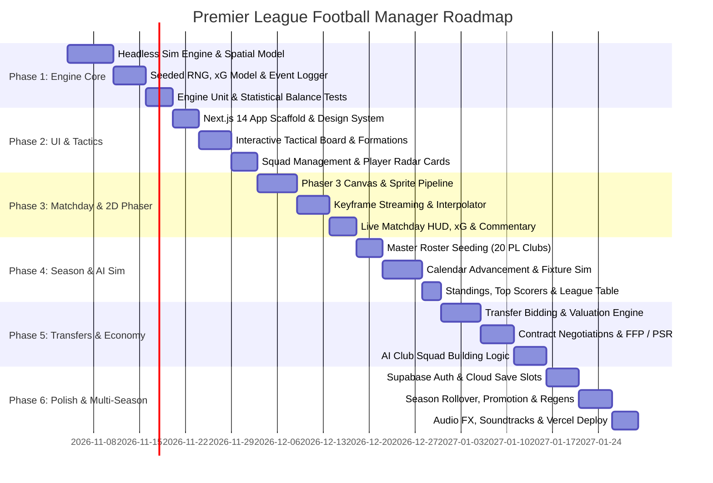

# Phased Development Roadmap

**Project:** Premier League Football Manager  
**Approach:** Agile / Milestone-Driven, Engine-First, Vertical Slices  

---

## Roadmap Overview

---

## Phase 1: Engine Core & Spatial Simulation (Milestone 1)
**Goal:** Deliver a 100% headless, testable match simulator in pure TypeScript with zero UI dependencies.

- [ ] **1.1 Spatial Math & Seeded RNG**: Implement continuous 2D coordinates $[105\text{m} \times 68\text{m}]$, ball physics (gravity, drag, bounce), and Mulberry32/Xoshiro128+ seeded PRNG.
- [ ] **1.2 Player State Machine**: Implement states (`Idle`, `Pressing`, `Tackling`, `Dribbling`, `Passing`, `Shooting`, `Goalkeeping`).
- [ ] **1.3 Duel & Resolution Model**: Attribute vs attribute contest formulas for tackles, aerial duels, and 1v1 dribbles.
- [ ] **1.4 xG Model & Event Emitter**: Analytical xG calculation per shot; structured event logging (`GOAL`, `YELLOW_CARD`, `INJURY`, etc.).
- [ ] **1.5 Headless CLI Runner & Calibration Suite**: Run automated test scripts generating 100 simulated matches to verify goal averages ($2.6–3.1$), card frequencies, and xG correlation.

**Exit Criteria:** Running `npm run test:engine` executes 50 matches in $<2$ seconds with deterministic output and zero NaN coordinates.

---

## Phase 2: Next.js Frontend Framework & Tactics System (Milestone 2)
**Goal:** Establish the web application shell, UI design system, squad views, and drag-and-drop tactical management.

- [ ] **2.1 Application Shell**: Setup Next.js 14+ App Router, Tailwind CSS, dark football management aesthetic, and responsive desktop layout.
- [ ] **2.2 State Management**: Implement Zustand stores for career state (`useCareerStore`), tactical setup (`useTacticsStore`), and squad selection (`useSquadStore`).
- [ ] **2.3 Drag-and-Drop Tactical Board**: Interactive pitch component allowing users to drag player tokens into positions, assign roles (e.g. Inverted Winger, Ball-Playing CB), and set instructions (Width, Tempo, Pressing Line).
- [ ] **2.4 Squad List & Player Dossier**: Roster table with sortable attributes, condition %, sharpness %, morale badges, and attribute radar charts.

**Exit Criteria:** User can select a club, customize their starting XI and tactical instructions, and have the tactical configuration validated and ready for the match engine.

---

## Phase 3: Matchday Experience & Phaser 2D Visualizer (Milestone 3)
**Goal:** Render the 2D pitch visualizer in Phaser 3 with smooth player movement, event commentary, and live tactical intervention.

- [ ] **3.1 Web Worker Integration**: Encapsulate `@engine/match-sim` inside a Web Worker to ensure match execution never drops a frame on the UI thread.
- [ ] **3.2 Phaser 3 Canvas & Pitch Renderer**: Render top-down pitch markings, grass shader/texture, goals, and team-colored player discs with kit numbers.
- [ ] **3.3 Position Interpolator (Lerp)**: Smoothly interpolate $4\text{Hz}$ engine keyframes to $60\text{fps}$ visual animations.
- [ ] **3.4 Live Match HUD**: Real-time scoreboard, game clock ($0'\to 90'$), possession bars, live shot/xG stats, and text commentary ticker.
- [ ] **3.5 Interactive Manager Controls**: Play, Pause, $1\times / 2\times / 4\times$ speed toggle, and in-game tactical adjustments (substitutions and mentality changes).

**Exit Criteria:** User can launch a match, watch 2D circles pass and shoot realistically, pause at half-time, make a substitution, and see the substitute appear on pitch.

---

## Phase 4: Season Loop & AI League Simulation (Milestone 4)
**Goal:** Enable full 38-game Premier League seasons with background fixture simulation and real-time standings.

- [ ] **4.1 Master Roster Dataset**: Seed 20 Premier League clubs with realistic 25-man rosters, authentic attributes, stadium details, and color schemes.
- [ ] **4.2 Calendar Advancement Engine**: "Continue" button jumps day-by-day; pauses on matchdays, transfer deadlines, and critical emails.
- [ ] **4.3 Fast Background Match Simulator**: Statistical match resolver for the other 9 fixtures per gameweek ($<2\text{ms}$ per match).
- [ ] **4.4 League Table & Stat Leaders**: Auto-updating standings table (P, W, D, L, GF, GA, GD, PTS) and player leaderboards (Golden Boot, Assists, Clean Sheets, Average Rating).

**Exit Criteria:** Manager can play an entire 38-game season, compete against AI clubs, and observe realistic final league tables.

---

## Phase 5: Transfers, Contract Negotiations & Club Economy (Milestone 5)
**Goal:** Implement realistic transfer market dynamics, multi-round contract negotiations, and financial accountability.

- [ ] **5.1 Player Valuation & Search Engine**: Multi-variable market value formula; filterable player database (by position, age, value, nationality).
- [ ] **5.2 Bidding & Counter-Offer System**: Submit cash bids, structured installments, and add-ons; AI clubs evaluate bids based on squad depth and valuation.
- [ ] **5.3 Contract Negotiation Dialog**: Negotiate weekly wages, squad status, contract length, release clauses, and signing bonuses with player agents.
- [ ] **5.4 Club Finances & Board Expectations**: Manage wage budgets, gate receipts, sponsorship income, and Premier League PSR compliance.

**Exit Criteria:** User can bid for an opposing player, negotiate terms through a multi-step interactive modal, sign them within financial limits, and field them in their squad.

---

## 6. Phase 6: Polish, Persistence, Multi-Season & Release (Milestone 6)
**Goal:** Multi-season rollover, cloud save sync with Supabase, audio effects, and production deployment on Vercel.

- [ ] **6.1 Supabase Cloud Persistence**: Authenticated user accounts, save slot serialization (under $500\text{KB}$ per career), and cloud sync.
- [ ] **6.2 Season Rollover & Youth Regens**: Relegation of bottom 3, promotion of top 3 Championship clubs, youth academy intake with procedurally generated regens.
- [ ] **6.3 Audio Ambience**: Crowd noise responding to goals, near misses, whistle sounds, and ambient stadium audio.
- [ ] **6.4 Production Hardening & Deployment**: Vercel deployment, edge caching for master data, RLS security audit, and mobile/tablet touch responsiveness.

**Exit Criteria:** Fully deployed on Vercel, playable multi-season career with cloud save/load and 60fps match playback.

