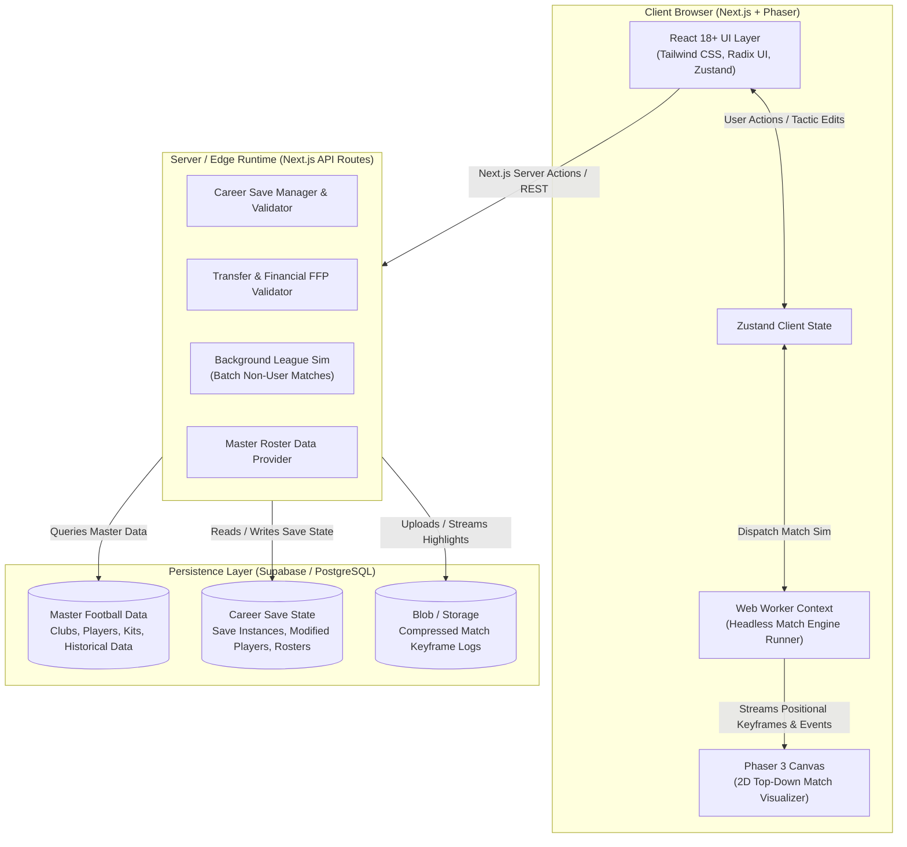
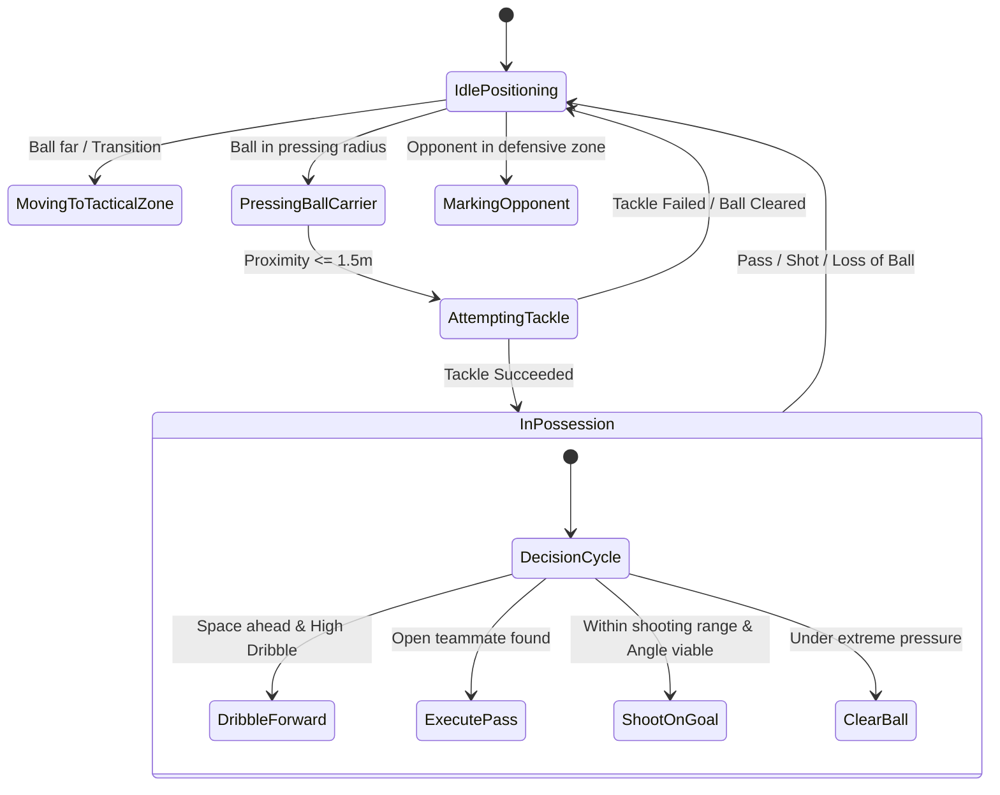
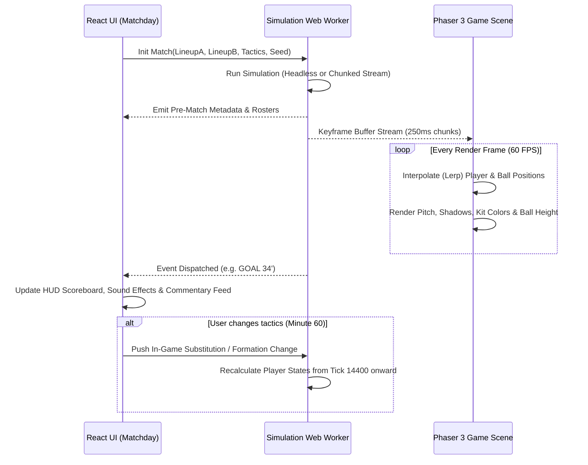

# System Architecture & Technical Specification

**Project:** Premier League Football Manager  
**Architecture:** Decoupled Headless Simulation Engine + Next.js App Router + Phaser 2D Visualizer + Supabase / PostgreSQL  

---

## 1. High-Level System Architecture



---

## 2. Match Simulation Engine Architecture (`@engine/match-sim`)

### 2.1 Core Principle: Decoupled & Headless
The match simulation engine has **zero DOM, React, or Phaser dependencies**. It is written in pure TypeScript and compiles to both Node.js (for server validation/background batch matches) and Web Workers (for non-blocking client-side simulation).

### 2.2 Spatial Model & Pitch Coordinate System
- **Pitch Dimensions**: Standard Premier League dimensions normalized to continuous coordinates:
  - Length ($X$ axis): $0.0\text{m} \le X \le 105.0\text{m}$ (Team A attacks towards $X = 105.0$, Team B towards $X = 0.0$).
  - Width ($Y$ axis): $0.0\text{m} \le Y \le 68.0\text{m}$ (Touchlines at $Y = 0.0$ and $Y = 68.0$; Center spot at $(52.5, 34.0)$).
  - Height ($Z$ axis for ball): $0.0\text{m} \le Z \le 5.0\text{m}$ (Ground level = $0.0$; Crossbar = $2.44\text{m}$).

```
Y = 68.0m ------------------------------------------------------------- (Touchline)
          |        |                      |                      |        |
          |  Goal  |     Defending 3rd    |     Middle 3rd       | Att 3rd| Goal
          |  [A]   |                      |                      |        | [B]
          |  X=0.0 |                      |    (52.5, 34.0)      |        | X=105.0
          |        |                      |                      |        |
Y = 0.0m  ------------------------------------------------------------- (Touchline)
```

### 2.3 Time Resolution & Simulation Ticks
- The match runs at **$4\text{Hz}$ simulation resolution** (1 tick = $250\text{ms}$).
- In 90 minutes of match play (+ stoppage time, approx. 95 minutes = 5,700 seconds), there are **22,800 ticks**.
- For headless execution, 22,800 ticks execute in **$\approx 30–50\text{ms}$** on modern JavaScript runtimes.
- During interactive Phaser playback, the engine runs inside a Web Worker and feeds keyframes to Phaser at $4\text{Hz}$, while Phaser linearly interpolates positions at **$60\text{fps}$** for silky smooth rendering.

### 2.4 Determinism & Seeded Randomness
All stochastic elements (shot deviations, tackle success, injury occurrence) use a fast seeded PRNG (**Mulberry32** or **Xoshiro128+**):
```typescript
export class SeededRNG {
  private state: number;
  constructor(seed: number) {
    this.state = seed;
  }
  public next(): number {
    let t = (this.state += 0x6d2b79f5);
    t = Math.imul(t ^ (t >>> 15), t | 1);
    t ^= t + Math.imul(t ^ (t >>> 7), t | 61);
    return ((t ^ (t >>> 14)) >>> 0) / 4294967296;
  }
  public range(min: number, max: number): number {
    return min + this.next() * (max - min);
  }
}
```
*Benefit:* Given the identical initial seed and starting lineups, a match replay can be reconstructed bit-for-bit without storing large coordinate streams.

### 2.5 Player State Machine & Spatial Agents



### 2.6 The Duel & Decision Resolution Matrix

When two players interact (e.g. Attacker $A$ dribbling vs Defender $D$ tackling), the engine calculates an **Action Win Probability**:

$$P(\text{Tackle Win}) = \sigma \left( \frac{\text{Tackling}_D + \text{Strength}_D \cdot 0.3 + \text{Anticipation}_D \cdot 0.3 - (\text{Dribbling}_A + \text{Agility}_A \cdot 0.3 + \text{Balance}_A \cdot 0.3)}{15} + \Delta_{\text{Fatigue}} \right)$$

Where $\sigma(z) = \frac{1}{1 + e^{-z}}$ (Sigmoid function).

### 2.7 Realistic Expected Goals (xG) Model
Every shot calculates an analytical xG value stored with the event:
$$xG = f(\text{Distance to Goal}, \text{Shot Angle}, \text{Body Part}, \text{Defenders in Cone}, \text{Goalkeeper Distance}, \text{Shot Type})$$
- Distance: Euclidean distance $\sqrt{(105 - x)^2 + (34 - y)^2}$.
- Shot Angle: Visible goal mouth angle between posts $(105, 30.34)$ and $(105, 37.66)$.
- Defenders in blocking cone: Raycast check of defending players within the triangular sightline from ball to goal posts.

### 2.8 Keyframe Data Format (Telemetry Payload)
To keep memory lightweight, coordinate keyframes omit unnecessary JSON overhead:
```typescript
export interface Keyframe {
  tick: number;              // Current tick index
  minute: number;            // Display minute (0-90+)
  second: number;            // Display second (0-59)
  ball: [number, number, number]; // [x, y, z] in meters
  // 22 players: [id, x, y, stateCode, staminaPct]
  players: Array<[number, number, number, number, number]>;
}

export interface MatchEvent {
  id: string;
  tick: number;
  minute: number;
  type: 'GOAL' | 'SHOT' | 'FOUL' | 'YELLOW_CARD' | 'RED_CARD' | 'OFFSIDE' | 'CORNER' | 'SUBSTITUTION' | 'INJURY';
  primaryPlayerId: string;
  secondaryPlayerId?: string; // Assist or tackler
  teamId: string;
  coordinates: [number, number];
  data?: {
    xG?: number;
    shotOutcome?: 'SAVED' | 'BLOCKED' | 'OFF_TARGET' | 'POST';
    injurySeverity?: 'MINOR' | 'MODERATE' | 'SEVERE';
  };
}
```

---

## 3. Phaser 2D Match Visualizer Integration

### 3.1 Architectural Separation
Phaser 3 acts strictly as a **playback and presentation canvas**. It does not compute physics or tactical AI; it consumes the stream of `Keyframe` and `MatchEvent` packets from the simulation engine.



### 3.2 React-Phaser Lifecycle Management
To avoid browser canvas memory leaks in Next.js:
1. Phaser is dynamically imported using `next/dynamic` with `{ ssr: false }`.
2. A single `Phaser.Game` instance is mounted to a React `ref` inside a `useEffect`.
3. Cleanup method rigorously destroys scenes, clears texture caches, and removes DOM event listeners on unmount.

---

## 4. Frontend Application Structure (Next.js 14+ App Router)

```
OG-PL-football-manager/
├── docs/                               # Game design & architectural documentation
├── public/                             # Static assets (club badges, pitch textures, audio)
│   ├── assets/kits/                    # SVG kits for 20 Premier League clubs
│   ├── assets/badges/                  # Club crests & competition logos
│   └── audio/                          # Whistle, crowd murmur, goal roar FX
├── src/
│   ├── app/                            # Next.js App Router
│   │   ├── (auth)/                     # Login, register, profile
│   │   ├── (game)/                     # Authenticated Game Layout
│   │   │   ├── dashboard/              # Club overview, next fixture, news feed
│   │   │   ├── squad/                  # Squad list, player profiles, contract status
│   │   │   ├── tactics/                # Pitch board, roles, formation selector, instructions
│   │   │   ├── transfers/              # Transfer market, search, shortlist, scout reports
│   │   │   ├── schedule/               # Fixtures, league table, results, cup brackets
│   │   │   ├── club/                   # Finances, board confidence, facilities, staff
│   │   │   ├── matchday/               # Live match view, Phaser 2D pitch, HUD, commentary
│   │   │   └── layout.tsx              # Sidebar navigation, top bar (date, balance, alerts)
│   │   ├── api/                        # Next.js Route Handlers (Server-side validation)
│   │   │   ├── careers/                # Create, save, load, delete career slots
│   │   │   ├── transfers/bid/          # Server validation of transfer bids & budgets
│   │   │   └── match/simulate-day/     # Server execution for background league matches
│   │   └── page.tsx                    # Landing page / New Career launcher
│   ├── components/                     # Reusable React UI Components
│   │   ├── ui/                         # Base design system (Button, Dialog, Dropdown, Slider)
│   │   ├── tactics/                    # Tactical pitch drag-and-drop, role assignment
│   │   ├── squad/                      # Attribute radar charts, condition bars, roster table
│   │   ├── match/                      # Scoreboard, commentary ticker, speed controls
│   │   └── layout/                     # GameHeader, GameSidebar, DateAdvancementButton
│   ├── engine/                         # PURE TYPESCRIPT SIMULATION ENGINE
│   │   ├── core/                       # MatchSimulator, SimulationLoop, SeededRNG
│   │   ├── entities/                   # Ball, PlayerAgent, Pitch, Team
│   │   ├── tactics/                    # TacticalModifier, Formations, Zones
│   │   ├── events/                     # EventResolver, DuelResolver, xGModel
│   │   ├── workers/                    # simulation.worker.ts (Web Worker entry)
│   │   └── types/                      # Keyframe, MatchEvent, PlayerAttributes, TacticsConfig
│   ├── phaser/                         # Phaser 2D Visualizer Scene
│   │   ├── scenes/                     # MatchScene.ts (Sprites, animations, lerping)
│   │   ├── objects/                    # PlayerSprite.ts, BallSprite.ts, PitchRenderer.ts
│   │   └── PhaserGame.tsx              # React wrapper for Phaser Game canvas
│   ├── stores/                         # Zustand State Management
│   │   ├── useCareerStore.ts           # Active career date, club ID, manager stats
│   │   ├── useTacticsStore.ts          # Active formation, instructions, starting XI
│   │   ├── useSquadStore.ts            # Current squad, morale, injuries
│   │   └── useMatchdayStore.ts         # Live match state, pause/play, speed multiplier
│   └── lib/                            # Utilities & Supabase client
│       ├── supabase/                   # Supabase client, queries, mutations
│       └── utils/                      # Formatting (£ currency, dates, ratings)
└── tests/                              # Automated test suites
    ├── engine/                         # Headless engine deterministic & balance tests
    ├── tactics/                        # Tactical impact validation tests
    └── transfers/                      # Financial & FFP calculation tests
```

---

## 5. Technical Risks & Mitigation Strategies

| Risk Area | Challenge | Architectural Mitigation |
| :--- | :--- | :--- |
| **Simulation Performance** | Simulating 10 Premier League matches per matchday (up to 380 per season) could cause browser frame drops or server timeouts. | **Dual-Engine Architecture**: User match runs full spatial simulation via Web Worker with keyframes; the remaining 9 background matches run a lightweight statistical resolver (resolves in $<2\text{ms}$ each based on team strength, form, and tactical matchup). |
| **Save Game Data Bloat** | Storing 20 clubs, 500+ players, and historical stats across seasons could bloat database storage per user. | **Delta-Persistence Pattern**: Master data is static. The save file only stores *deltas* (modified attributes, transfers, contract updates, and season summary rows), keeping individual save slots under $500\text{KB}$. |
| **Memory Leaks in Phaser** | Navigating between Next.js pages (e.g. from Matchday to Dashboard) can leak WebGL/Canvas contexts in the browser. | Strict React cleanup hook destroying the Phaser Game instance, disconnecting event listeners, and freeing sprite texture memory upon navigating away from `/matchday`. |
| **Determinism Desync** | Replays or server verification deviating from client match events. | Strict integer/float precision clamping, isolation from `Math.random()`, and reliance on a single seeded PRNG seed saved alongside match metadata. |
| **Client-Side Cheat Injection** | Users modifying JS state to give themselves £500m transfer budget or instant 99 stats. | **Server-Side Validation**: All critical actions (transfer bids, contract signings, matchday completion) validate through Next.js Server Actions / API routes before committing to Supabase. |

---

## 6. Automated Testing Requirements

1. **Deterministic Match Sim Tests**:
   - Given fixed Seed `12345` and identical rosters, run simulation twice; verify identical score, shot counts, and event timestamps.
2. **xG & Balance Calibration Tests**:
   - Simulate 1,000 automated matches between Man City and Sheffield United. Verify statistically sound distributions:
     - Man City win rate: $75\%–85\%$.
     - Average goals per match: $2.6–3.1$.
     - Average yellow cards per match: $3.0–4.5$.
     - Zero NaN coordinates or division-by-zero exceptions in spatial keyframes.
3. **Financial & Contract Validation Tests**:
   - Verify that clubs cannot exceed their approved wage budget.
   - Verify that transfer bids are rejected if liquid balance is insufficient.
4. **Calendar & Season Rollover Tests**:
   - Advance through 38 matchdays.
   - Confirm proper relegation of bottom 3 teams, promotion of 3 teams, and European spot assignment.

